<div align="center">


# Liqua

**결제 알림을 자동으로 기록하고 오늘 쓸 돈을 알려 주는 자산관리 앱**

`하루 생활비` · `자동 기록` · `성장형 펫`


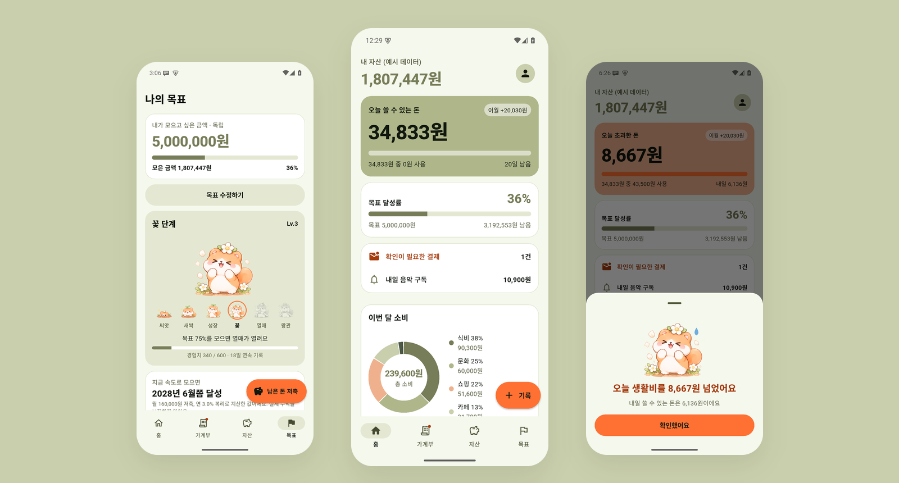

**프로젝트** · 성결대학교 미디어소프트웨어학과 M&M 소모임 멘토링 프로젝트 (2026-2, 앱/AI 파트)  
**기간** · 2026-10-02 ~ 2026-11-26  
**팀** · 백정범 (앱 구현, Claude Code 협업) 외 3명  

</div>

---

## 한 줄 요약

Liqua는 사회초년생과 대학생을 위한 자산관리 앱입니다.
결제 알림에서 금액과 가맹점을 읽어 가계부에 기록하고, 다음 수입일까지 하루에 쓸 수 있는 돈을 계산합니다.
아낀 돈이 목표 저축으로 이어지고, 목표 달성률에 따라 펫이 자랍니다.
팀이 공모전 기획서로 기능과 화면을 설계했고, 팀장이 AI 코딩 도구 Claude Code와 함께 Flutter와 Firebase로 앱을 구현했습니다.

> **핵심** — 결제 알림 → 자동 기록 → 하루 생활비 갱신 → 과소비 경고 → 펫 성장까지 한 흐름으로 이어집니다.

---

## 스크린샷

<div align="center">

<table>
<tr>
<td align="center">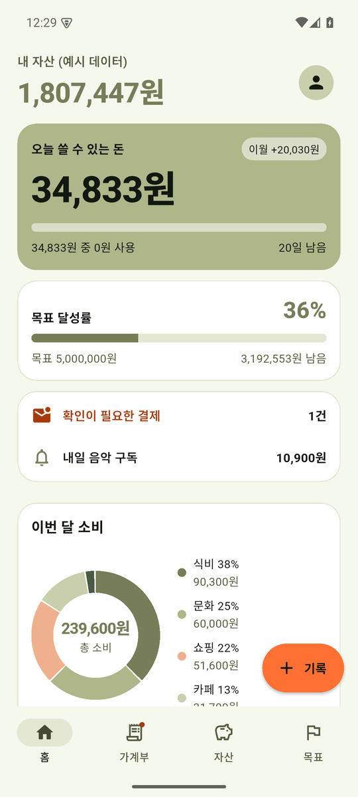<br><sub><b>홈</b></sub></td>
<td align="center">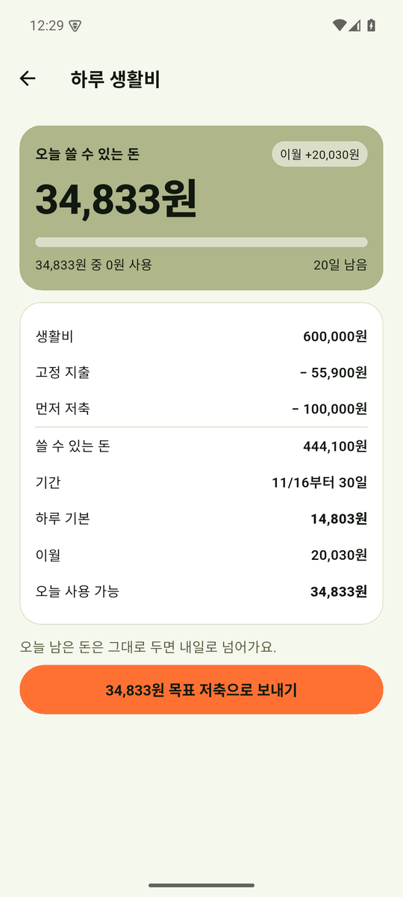<br><sub><b>하루 생활비</b></sub></td>
<td align="center">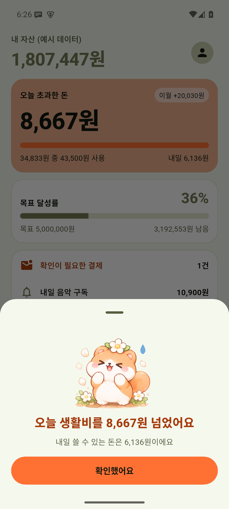<br><sub><b>과소비 경고</b></sub></td>
<td align="center">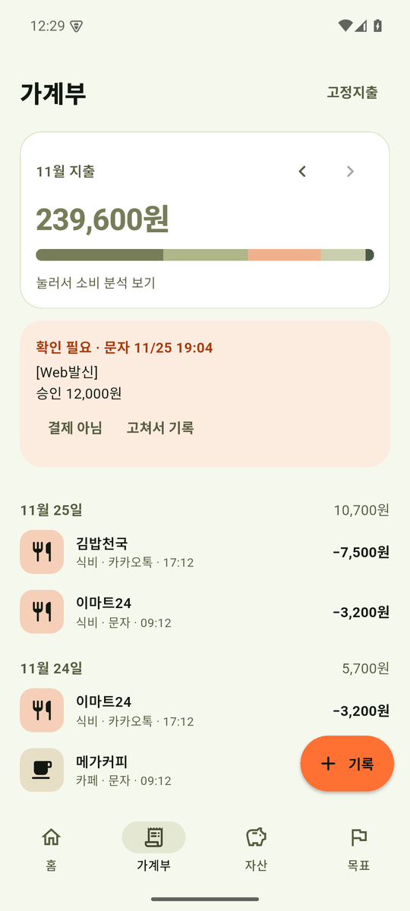<br><sub><b>가계부</b></sub></td>
</tr>
<tr>
<td align="center">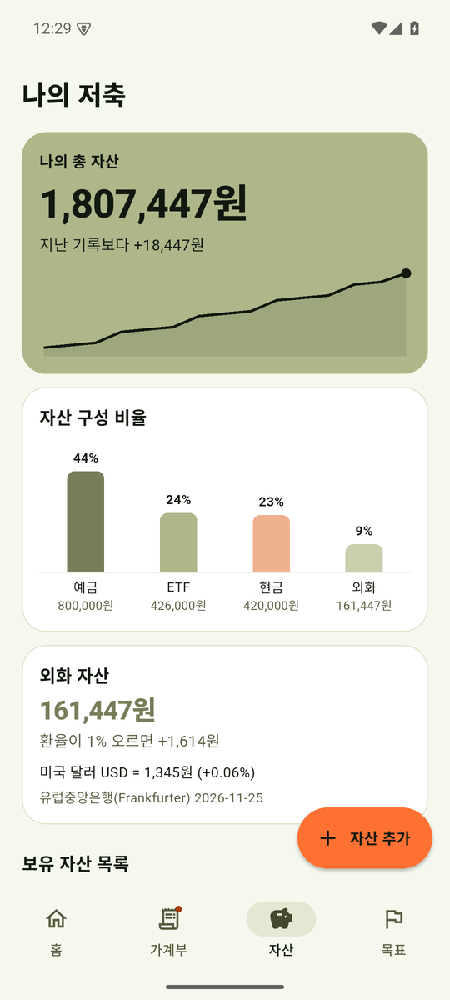<br><sub><b>자산</b></sub></td>
<td align="center">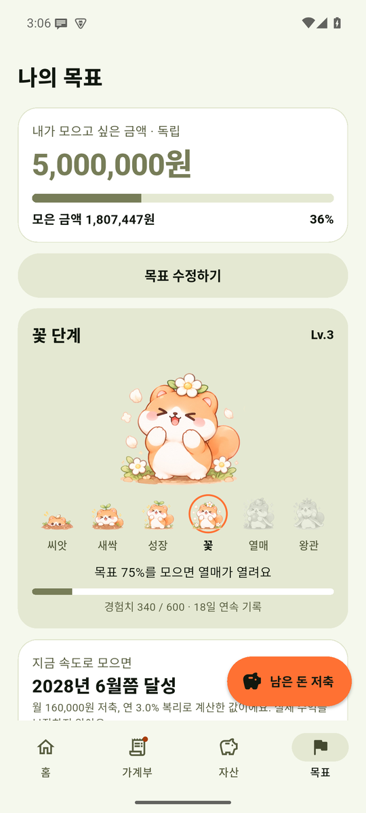<br><sub><b>목표와 펫</b></sub></td>
<td align="center">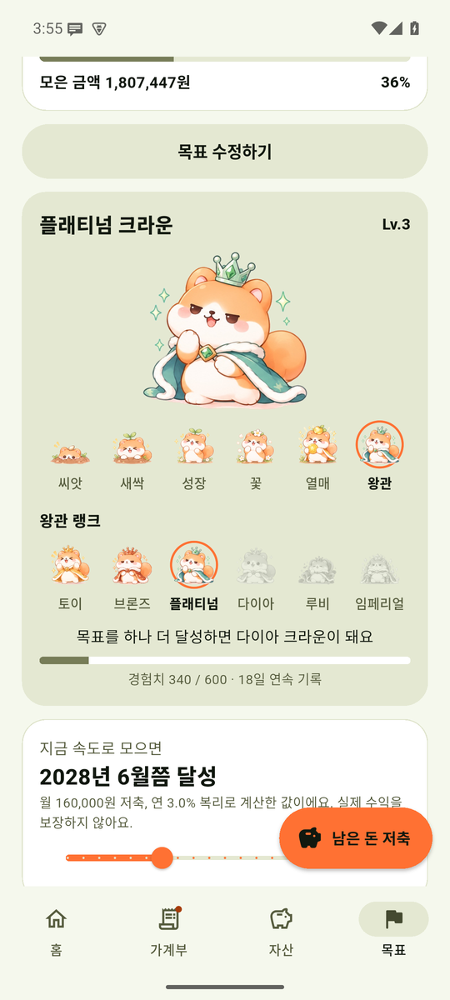<br><sub><b>왕관 랭크</b></sub></td>
<td align="center">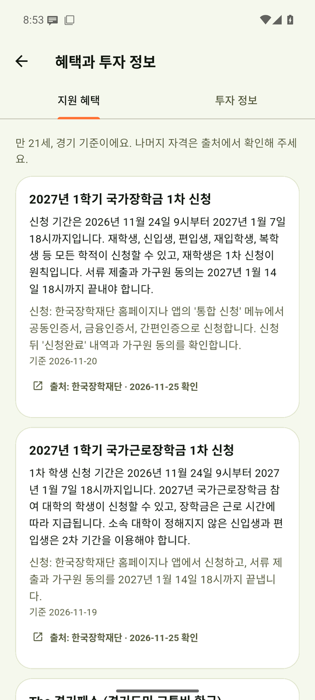<br><sub><b>혜택과 투자 정보</b></sub></td>
</tr>
<tr>
<td align="center">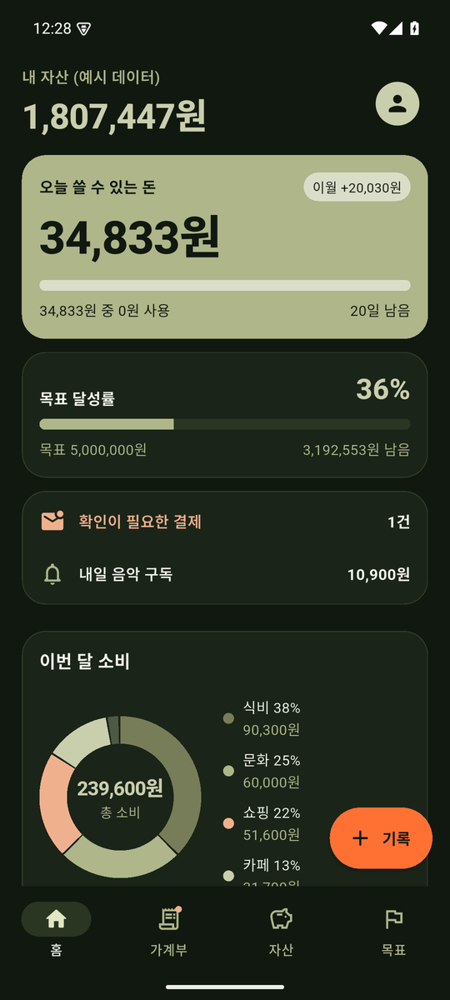<br><sub><b>다크 홈</b></sub></td>
<td align="center">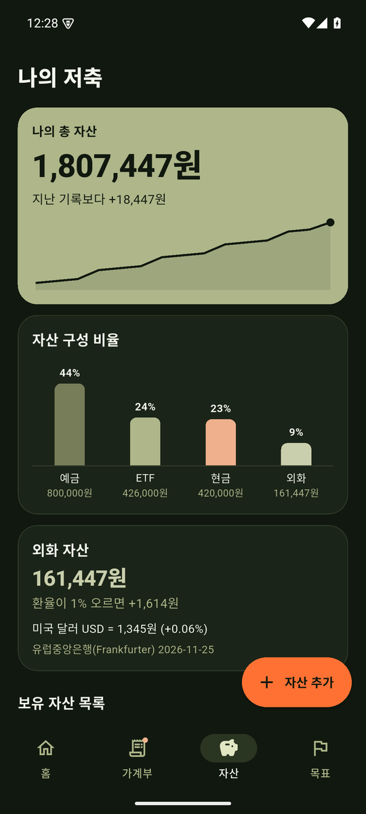<br><sub><b>다크 자산</b></sub></td>
<td align="center">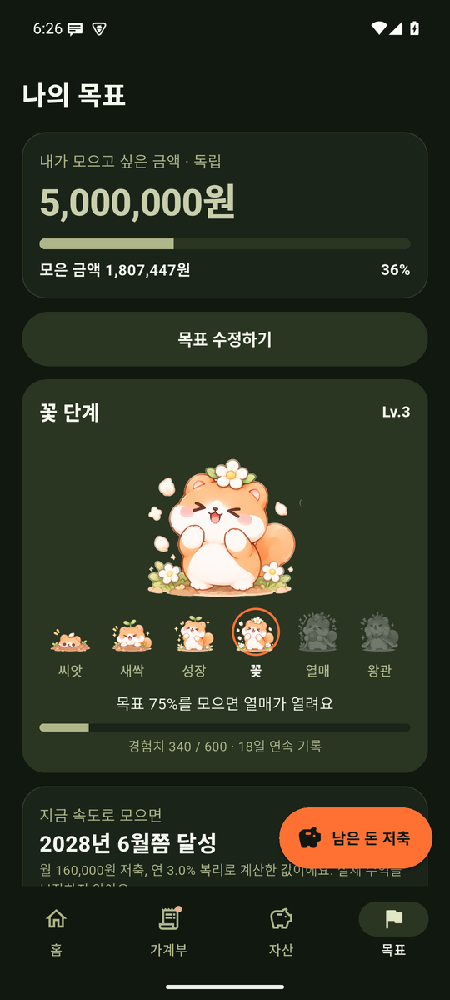<br><sub><b>다크 목표</b></sub></td>
</tr>
</table>

</div>

화면은 Android 에뮬레이터에서 예시 데이터로 찍었습니다. 왕관 랭크 화면은 목표를 3번 달성한 상태로 바꿔 찍었습니다.

### 펫 성장과 왕관 랭크

기록을 이어 가고 목표에 가까워질수록 펫이 자랍니다. 왕관에 닿은 뒤에는 목표를 하나 이룰 때마다 랭크가 오릅니다.

<table>
<tr><th>성장</th><td align="center"><br><sub>씨앗</sub></td><td align="center"><br><sub>새싹</sub></td><td align="center"><br><sub>성장</sub></td><td align="center"><br><sub>꽃</sub></td><td align="center"><br><sub>열매</sub></td><td align="center"><br><sub>왕관</sub></td></tr>
<tr><th>랭크</th><td align="center"><br><sub>토이</sub></td><td align="center"><br><sub>브론즈</sub></td><td align="center"><br><sub>플래티넘</sub></td><td align="center"><br><sub>다이아</sub></td><td align="center"><br><sub>루비</sub></td><td align="center"><br><sub>임페리얼</sub></td></tr>
</table>

---

## 왜 이 프로젝트인가

| 사용자의 문제 | 앱에서의 해결 |
| --- | --- |
| 매일 소비 내역을 직접 기록하기 번거로워 꾸준히 관리하기 어렵다 | 결제 알림에서 금액, 가맹점, 시각을 읽어 자동으로 기록한다 |
| 월급날까지 생활비와 고정지출 납부일을 관리하기 복잡하다 | 하루 생활비를 계산하고, 고정지출은 결제일 하루 전에 알린다 |
| 현금, 예금, 투자, 외화가 흩어져 있어 전체 자산을 파악하기 어렵다 | 자산을 한 화면에 모으고 외화는 환율로 원화 환산한다 |
| 금융 정보와 지원 혜택을 찾기 어렵고 믿을 만한지 알기 어렵다 | 공식 자료에서 찾은 근거로만 답하고, 근거가 없으면 「확인된 정보 없음」이라고 답한다 |
| 저축 목표를 세워도 동기부여가 부족해 꾸준히 실천하기 어렵다 | 목표 달성률에 따라 펫이 자라고, 목표를 이룰 때마다 왕관 랭크가 오른다 |

---

## 주요 기능

### ✅ 구현됨

1. **Google 로그인** — Google 계정으로 로그인하고, 데이터는 계정마다 따로 저장한다.
2. **예시로 둘러보기** — 로그인 없이 예시 데이터로 모든 화면을 볼 수 있다. 이때 바꾼 내용은 저장되지 않는다.
3. **첫 사용 인터뷰** — 나이, 수입, 지역, 투자 경험, 위험 성향, 모으는 이유를 질문 6개로 묻고 생활비 계획을 세운다.
4. **하루 생활비** — (생활비 - 고정지출 - 먼저 저축할 돈) ÷ 남은 날로 계산하고, 남은 돈은 이월하거나 저축으로 보낸다.
5. **결제 알림 자동 기록** — Android 알림에서 문자, 카카오톡, 카드·은행 앱의 결제를 읽어 기록한다. 같은 결제는 한 건으로 합치고, 취소 알림은 원래 기록을 되돌린다. 견본 알림과 에뮬레이터로 시험했다.
6. **확인이 필요한 결제** — 읽지 못한 알림은 버리지 않고 원문과 함께 남겨 사용자가 고친다.
7. **가계부** — 수입과 지출을 직접 추가, 수정, 삭제하고 삭제는 되돌릴 수 있다. 월별로 넘겨 보고, 자주 쓴 분류를 먼저 보여 준다.
8. **과소비와 급감 경고** — 하루 생활비를 넘거나 자산이 하루에 10% 이상 줄면 알린다.
9. **고정지출 알림** — 결제일 하루 전 오전 9시에 기기 안 예약 알림을 보낸다.
10. **자산과 외화** — 현금, 예금, 주식, ETF, 외화를 관리하고 자산 구성 비율과 변화를 그래프로 보여 준다. 환율은 공개 API에서 받고, 끊기면 마지막 값을 쓴다.
11. **목표와 달성 예측** — 목표 금액과 달성률을 보여 주고, 지금 저축 속도로 언제 달성하는지 계산한다.
12. **펫 성장과 왕관 랭크** — 씨앗, 새싹, 성장, 꽃, 열매, 왕관 6단계로 자라고, 왕관부터는 목표를 달성할 때마다 토이부터 임페리얼까지 6랭크가 오른다.
13. **AI 상담** — 앱에 저장된 공식 자료 28건을 먼저 찾고, 찾은 자료로만 Gemini가 답한다. 답에 출처 링크를 붙이고, 종목 매수를 권하는 답은 걸러 낸다.
14. **혜택과 투자 정보** — 인터뷰에서 받은 나이, 지역, 위험 성향에 맞는 지원 혜택과 투자 정보를 출처와 함께 보여 준다.
15. **다크 모드** — 기기 설정에 따라 팀 팔레트의 라이트와 다크 화면으로 바뀐다.
16. **Firestore 보안 규칙** — 로그인한 본인만 자기 데이터를 읽고 쓰게 하고, 에뮬레이터 시험 183개로 확인했다.

### 🛠 다음 단계

- **결제 알림 AI 보완** — 규칙으로 읽지 못한 알림 문구를 AI가 채운다.
- **이메일 영수증 기록** — 기획서의 이메일 결제 알림 읽기를 추가한다.
- **실제 카드사 알림 수집** — 견본 대신 실제 카드, 은행 앱 알림으로 읽기 규칙을 검증한다.
- **주식 시세 연동** — 보유 주식의 현재가를 자동으로 갱신한다.
- **iOS와 Web 지원** — 기획서 계획대로 Android 밖으로 넓힌다.
- **AI 심층 자산 분석** — 기획서의 수익 구조에 있는 유료 구독용 맞춤 리포트를 만든다.

---

## 기술 스택

| 구분 | 기술 |
| --- | --- |
| Frontend | Flutter (Dart), flutter_localizations, intl, cupertino_icons |
| Auth·DB | firebase_core, firebase_auth, google_sign_in, cloud_firestore, firebase_app_check |
| 기타 패키지 | http, url_launcher, flutter_local_notifications, timezone, shared_preferences |
| AI 협업 | Gemini (firebase_ai, 앱 안 AI 상담), Claude Code (앱 코드 작성 협업) |

---

## 디자인

| 색 | 쓰임 | 이름 | 값 |
| :---: | --- | --- | --- |
|  | 메인 | 파스텔 올리브 | `#AEB68A` |
|  | 보조 | 소프트 세이지 | `#C9CEAC` |
|  | 글자 강조 | 딥 올리브 | `#777D58` |
|  | 포인트 | 피치 오렌지 | `#EFB18D` |
|  | 주요 버튼 | Warm Orange | `#FF7133` |
|  | 라이트 배경 | Light Green | `#F5F8ED` |
|  | 다크 배경 | Dark Green | `#11180F` |

- 주황과 올리브 위 흰 글씨는 대비가 2.74, 2.13이라 다크 그린 글씨를 쓴다(6.60, 8.49).
- 폭 320px부터 글씨 2배까지 글자가 넘치지 않는지 자동으로 시험한다.
- 펫 캐릭터 그림은 GPT 이미지 생성으로 만들었다.
- UX 원칙을 어디에 썼는지는 [docs/ux.md](./docs/ux.md)에 정리했다.

---

## 구조

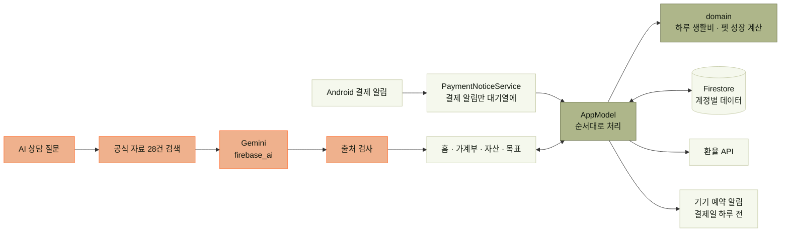

### 디렉터리 구조

```
lib/
├── main.dart                  # 앱 시작, Firebase와 App Check 초기화
├── firebase_options.dart      # Firebase 프로젝트 연결 설정
├── data/
│   ├── app_model.dart         # 앱 상태와 기록, 경고, 저축 처리
│   ├── demo.dart              # 둘러보기용 예시 데이터
│   ├── models.dart            # 거래, 고정지출, 설정 등 데이터 모양
│   └── store.dart             # Firestore와 메모리 저장소
├── domain/
│   ├── budget.dart            # 하루 생활비와 이월 계산
│   ├── growth.dart            # 펫 성장 단계, 왕관 랭크, 경험치
│   ├── insight.dart           # 분류별 소비 분석
│   ├── interview.dart         # 첫 사용 인터뷰 질문
│   ├── money.dart             # 통화, 금액 표시
│   ├── notice_parser.dart     # 결제 알림 해석과 중복 판단
│   └── rag.dart               # 공식 자료 검색과 답변 검사
├── models/
│   └── asset.dart             # 자산 데이터 모양
├── screens/
│   ├── asset_screen.dart      # 자산 화면
│   ├── book_screen.dart       # 가계부, 고정지출 화면
│   ├── chat_screen.dart       # AI 상담, 혜택과 투자 정보 화면
│   ├── gate.dart              # 로그인과 로딩 화면
│   ├── goal_screen.dart       # 목표와 펫 화면
│   ├── home_screen.dart       # 홈, 하루 생활비 상세 화면
│   ├── onboarding.dart        # 첫 인터뷰와 생활비 설정
│   ├── settings_screen.dart   # 설정 화면
│   └── shell.dart             # 아래 탭과 주요 버튼
├── services/
│   ├── ai_service.dart        # Gemini 호출과 답변 해석
│   ├── auth_service.dart      # Google 로그인
│   ├── device_service.dart    # 결제 알림 받기, 예약 알림
│   └── fx_service.dart        # 환율 조회
├── theme/
│   └── app_theme.dart         # 팀 팔레트, 라이트·다크 테마
└── ui/
    └── widgets.dart           # 공통 위젯, 펫 그림
```

---

## 설계에서 정한 것

1. 숫자는 코드가 계산하고 AI는 설명만 한다. AI 답은 출처 id가 실제 자료와 맞을 때만 보여 준다.
2. 알림 원문은 결제로 보이는 것만 저장한다. AI에는 이름과 결제 원문을 보내지 않는다.
3. 기획서의 이월 공식은 이월이 있는 날 초과하면 같은 돈을 두 번 더한다. 실제로 남은 돈을 넘기도록 고쳤고, 기획서의 예시 값은 그대로 나온다.
4. 자동 기록은 로그인한 계정으로만 모으고, 로그아웃하면 대기열과 예약 알림을 지운다.
5. 알림은 저장이 끝난 뒤에만 대기열에서 지운다.

---

## 팀 구성과 역할

| 사진 | 이름 | 깃허브 | 역할 | 기록 |
| :---: | :---: | :---: | :--- | :---: |
|  | 백정범 | [@beakjungbum](https://github.com/beakjungbum) | 팀장 · 백엔드, 회의 주도, 계획서 작성 참여 | [보기](./docs/contributions/beakjungbum.md) |
|  | 김윤정 | [@vbr061003a10](https://github.com/vbr061003a10) | 기획서 초안, 회의록, 화면·펫 디자인 초안, 로고 | [보기](./docs/contributions/vbr061003a10.md) |
|  | 양세영 | [@earlgreyvanillacreamlatte](https://github.com/earlgreyvanillacreamlatte) | 기능 기획, 디자인 피드백, 작업 검토 | [보기](./docs/contributions/earlgreyvanillacreamlatte.md) |
|  | 용성은 | [@yongsungeun](https://github.com/yongsungeun) | 디자인, 기획서 통합, 발표 PPT, Figma 와이어프레임 | [보기](./docs/contributions/yongsungeun.md) |

- **앱 코드 구현** · 백정범
- **전원** · M&M 멘토링 수업에서 멘토 코드를 직접 작성하고 수정하며 Flutter·Firebase 실습

---

## 트러블슈팅

### 1. 문제 정의를 어느 칸에 넣을지 헷갈림
**증상** — 기획서 문제 정의에 사용자 관점의 문제들을 미리 써 두었는데, 「해결 문제」와 「현재 문제점」 중 어디에 넣을지 정하지 못했다.  
**원인** — (직접 작성: 두 칸이 헷갈린 이유)  
**해결** — 고민을 팀에 이야기했고, 성은님의 의견을 받아 정리했다.  

### 2. 사업 구조의 「서비스 운영 방식」과 「사업 운영 방식」 구분
**증상** — 기획서 사업 구조 칸을 쓰는 데 어려움이 있었다.  
**원인** — 서비스 운영 방식과 사업 운영 방식이 각각 무엇을 뜻하는지 헷갈렸다.  
**해결** — 팀원들이 각자 이해한 의미를 알려 주어 기획서가 원하는 뜻에 맞게 썼다.  

### 3. 팀원 일정이 달라 함께 참여하기 어려움
**증상** — 팀원마다 일정이 달라 자주 함께 참여하기 어려웠다.  
**원인** — 거리가 멀어 직접 만나지 못했고, 온라인 소통에 한계가 있었다.  
**해결** — 역할을 미리 나누어 각자 할 수 있는 일을 먼저 하고, 확인할 일은 연락 가능한 시간에 빠르게 답해 기한 안에 마쳤다.  

### 4. 금융 서비스의 운영 방식 정하기
**증상** — 기획서의 사업 운영 방식 칸을 어떻게 써야 할지 고민했다.  
**원인** — 금융 정보를 다루는 서비스라 개인정보와 자산 데이터 보호가 가장 중요했다.  
**해결** — 서버 보안 체계, 정기 보안 점검, 외부 API 정확성 확인, 서비스 오류 모니터링을 중심으로 운영 방식을 썼다.  

### 5. 배포용 앱에서 Google 로그인 실패
**증상** — 폰에 설치한 배포용 앱에서 「serverClientId must be provided on Android」 오류로 로그인이 안 됐다.  
**원인** — 배포용 빌드가 쓰지 않는 리소스를 지우면서 로그인용 웹 클라이언트 ID까지 지웠다.  
**해결** — `android/app/src/main/res/raw/keep.xml`로 그 값을 지우지 않게 하고, 다시 빌드해 확인했다.  

---

## 알려진 한계

- 스크린샷과 둘러보기 화면은 예시 데이터다.
- 결제 알림 읽기는 형식을 흉내 낸 견본 알림으로 시험했다. 실제 카드, 은행 앱 알림은 확인하지 않았다.
- Firestore 동기화와 Gemini 답변은 실제 서버에서 아직 확인하지 못했다. 콘솔에 보안 규칙과 App Check 토큰을 등록해야 한다.
- 결제 알림 자동 기록은 Android에서만 동작한다.
- 앱이 완전히 꺼져 있으면 결제는 대기열에 쌓였다가 다음 실행 때 기록되고, 경고도 그때 뜬다.
- 같은 앱, 같은 가게에서 같은 분에 같은 금액을 두 번 결제하면 한 건으로 합친다.
- 짝을 찾지 못한 취소와 부분 취소는 「확인이 필요한 결제」로 남는다.
- 공식 자료 28건은 2026-11-25에 확인한 값이라 주기적으로 갱신해야 한다.

---

## 실행 방법

```bash
flutter pub get
flutter run
```

- Flutter 3.50과 JDK 21에서 빌드를 확인했다.
- 로그인 없이 「예시로 둘러보기」로 모든 화면을 볼 수 있다.
- Google 로그인과 AI는 Firebase 프로젝트에 앱 서명 SHA-1과 App Check 토큰을 등록해야 동작한다.
- 수출입은행 환율을 쓰려면 `--dart-define=EXIM_KEY=발급키`를 붙인다. 없으면 유럽중앙은행 환율을 쓴다.

### 시험

```bash
flutter analyze
flutter test
cd rules-test && npm ci && npm test   # Java 17 이상, Firestore 에뮬레이터
```

---

## 크레딧

| <a href="https://github.com/woo-2003"></a> | <a href="https://github.com/N3skafe"></a> |
| :---: | :---: |
| [정우영](https://github.com/woo-2003) · 앱/AI 파트 | [김동준](https://github.com/N3skafe) · 백엔드 파트 |

성결대학교 미디어소프트웨어학과 M&M 소모임 멘토링 (2026-2)
