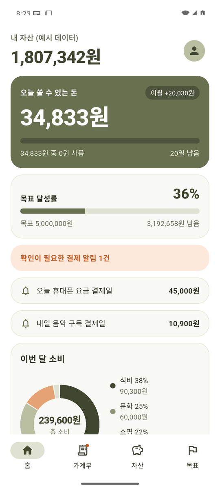
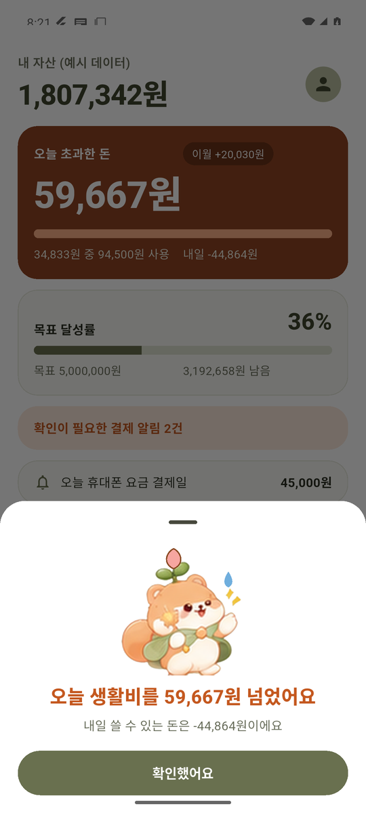
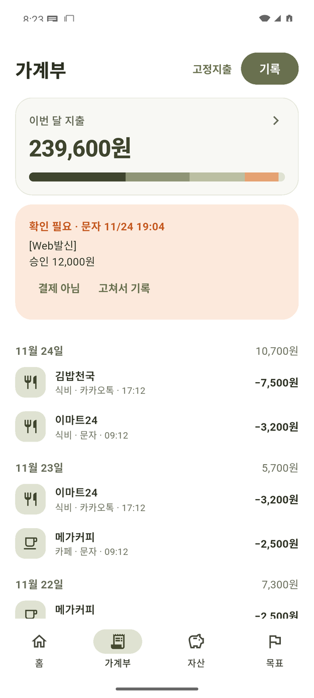
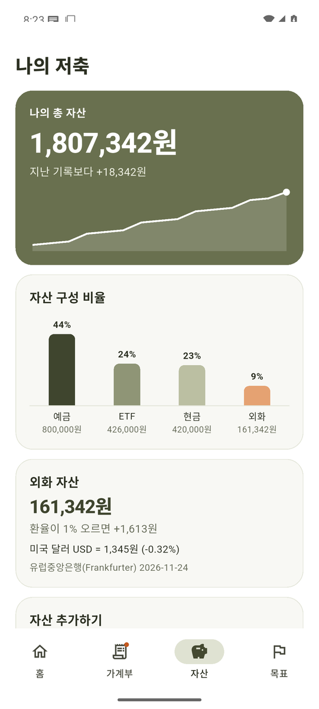
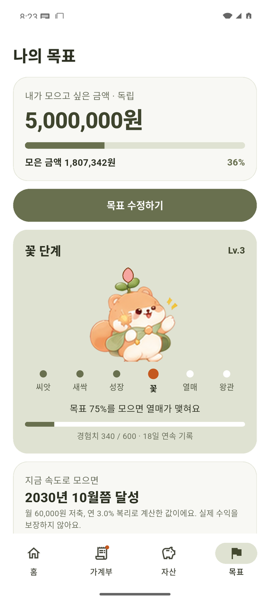
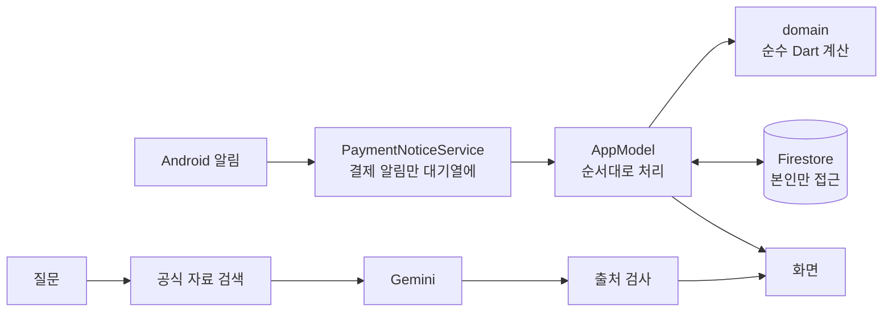

# Liqua

결제 알림이 오면 저절로 기록하고, 오늘 쓸 수 있는 돈을 알려 주는 자산 관리 앱입니다.
성결대 미디어소프트웨어학과 AI 아이디어 창업 공모전 기획을 실제 앱으로 만들었습니다.

| 홈 | 하루 생활비 | 과소비 경고 |
|---|---|---|
|  |  |  |

| 가계부 | 자산 | 목표와 펫 |
|---|---|---|
|  |  |  |

화면은 Android 에뮬레이터에서 예시 데이터로 찍었습니다.

## 기능

| 기능 | 동작 |
|---|---|
| 결제 알림 자동 기록 | 문자와 카카오톡 알림에서 금액, 가맹점, 시각을 읽는다. 같은 결제가 두 앱에서 오면 한 건으로 합치고, 취소 알림은 원래 기록을 되돌린다 |
| 확인 필요 | 읽지 못한 결제는 버리지 않고 원문과 함께 남긴다 |
| 하루 생활비 | (생활비 - 고정지출 - 저축) ÷ 남은 날. 남은 돈은 이월하거나 저축으로 보낸다 |
| 과소비와 급감 경고 | 하루 생활비를 넘는 순간, 자산이 하루에 10% 이상 줄 때 알린다 |
| 고정지출 알림 | 결제일 하루 전 오전 9시, 기기 안 예약 알림 |
| 자산과 외화 | 현금, 예금, 주식, ETF, 외화. 환율은 공개 API 에서 받고 끊기면 마지막 값을 표시한다 |
| 펫 성장 | 씨앗, 새싹, 성장, 꽃, 열매, 왕관 여섯 단계 |
| AI 상담 | 저장된 공식 자료 28건을 먼저 찾고, 찾은 자료로만 답한다. 출처가 없으면 「확인된 정보 없음」 |
| 혜택과 투자 정보 | 나이, 지역, 위험 성향에 맞춰 거른다. 종목 매수를 권하지 않는다 |

## 구조



- `lib/domain` 계산과 해석. Flutter 에 기대지 않아 빠르게 시험한다
- `lib/data` 저장소와 상태. 로그인하면 Firestore, 둘러보기는 메모리
- `lib/services` 로그인, AI, 환율, 기기 알림
- `firestore.rules`, `rules-test` 보안 규칙과 에뮬레이터 시험

## 설계에서 정한 것

1. 숫자는 코드가 계산하고 AI 는 설명만 한다. AI 답은 출처 id 가 실제 자료와 맞을 때만 보여 준다.
2. 알림 원문은 결제로 보이는 것만 저장한다. AI 에는 이름과 결제 원문을 보내지 않는다.
3. 기획서의 이월 공식은 이월이 있는 날 초과하면 같은 돈을 두 번 더한다. 실제로 남은 돈을 넘기도록 고쳤고, 기획서의 예시 값은 그대로 나온다.
4. 알림은 저장이 끝난 뒤에만 대기열에서 지운다.

## 실행

```bash
flutter pub get
flutter run
```

Flutter 3.50 과 JDK 21 에서 빌드를 확인했습니다. 로그인 없이 「예시로 둘러보기」로 모든 화면을 볼 수 있습니다.
Google 로그인과 AI 는 Firebase 프로젝트에 앱 서명 SHA-1 과 App Check 토큰이 등록되어 있어야 합니다.
수출입은행 환율을 쓰려면 `--dart-define=EXIM_KEY=발급키` 를 붙입니다. 없으면 유럽중앙은행 환율을 씁니다.

## 시험

```bash
flutter analyze
flutter test
cd rules-test && npm ci && npm test   # Java 17 이상, Firestore 에뮬레이터
```

## 아직 안 된 것

- 카드 알림은 형식을 흉내 낸 견본 12종으로 시험했다. 실제 카드사 알림 수집은 남아 있다.
- 앱이 완전히 꺼져 있으면 결제는 대기열에 쌓이고 다음 실행 때 기록된다. 이때 경고도 다음 실행 때 뜬다.
- iPhone 의 메일 영수증, 공유 버튼 입력과 주식 시세 연동은 만들지 않았다.
- 읽지 못한 알림을 AI 가 보완하는 기능은 만들지 않았다. 사용자가 직접 고친다.
- 공식 자료는 2026-11-25 에 확인한 값이라 주기적으로 갱신해야 한다.
